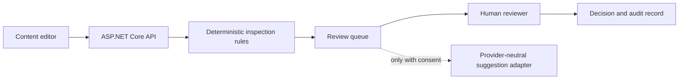

# Architecture

AccessFlow is designed as a narrow, auditable review workflow rather than an automatic accessibility certification service.

## Layers

- **Domain** contains the content item, review decision and accessibility finding models.
- **Application** owns use cases: inspect, submit, decide and produce a guarded suggestion.
- **Infrastructure** provides a local in-memory repository so anyone can run the demo immediately.
- **API** exposes the workflow and serves the accessible review desk UI.

## Production path

The local adapter is intentionally dependency-free. The next production increment replaces it with PostgreSQL persistence, Azure Blob Storage for source files, Azure Service Bus for long-running inspections and OpenTelemetry/Application Insights for tracing. `docker-compose.yml` supplies a local PostgreSQL service for that increment.

## Non-goals

- It does not claim WCAG conformance from automated checks alone.
- It does not send submitted content to an external model by default.
- It does not publish, rewrite or alter source content automatically.
